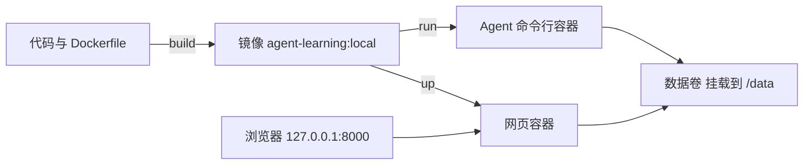

# 用客服 Agent 学习 Docker

当前状态：Docker 已安装；镜像构建、网页启动、数据卷保留、离线会话恢复与容器内初次 84 项测试均已实测通过。真实模型问答、草稿更新和确认建单已观察成功，工单 2 接口查询通过；重复确认与用户网页核对仍待记录，详见验收记录。

## 1．先理解四个概念

| 概念 | 在本项目中是什么 |
|---|---|
| Dockerfile | 构建步骤：准备 Python、安装锁定依赖、复制代码、设置启动命令 |
| 镜像 Image | 包含 Linux 用户空间、Python、依赖和代码的运行模板 |
| 容器 Container | 从镜像启动的一次应用运行，有自己的进程和文件系统 |
| 数据卷 Volume | 独立保存 SQLite 数据库和日志，供重建后的容器继续使用 |

Compose 用 compose.yaml 保存端口、环境变量和数据卷等运行参数。



镜像不包含本机的 .env、数据库、日志和 .git。本项目使用 .dockerignore 的文件白名单。

## 2．Windows 安装与验收

先下载并安装 [Docker Desktop for Windows](https://docs.docker.com/desktop/setup/install/windows-install/)，
选择符合电脑架构的安装包，使用 WSL 2 后端和 Linux 容器。
如果缺少 WSL，按照 [微软 WSL 安装说明](https://learn.microsoft.com/en-us/windows/wsl/install)，
在管理员 PowerShell 执行 `wsl --install`，按提示重启，再继续 Docker Desktop 安装。
安装涉及系统组件和重启，由你在桌面按提示完成。

启动 Docker Desktop，等待引擎运行。重新打开 PowerShell 或 PyCharm 终端，依次执行：

```powershell
docker version
docker compose version
docker run --rm hello-world
```

验收：docker version 同时显示 Client 和 Server；Compose 有版本号；最后看到
`Hello from Docker!`。只有 Client 但没有 Server 时，先检查 Docker Desktop 是否启动。
拉取超时属于镜像下载问题，记录错误后排查网络，不要先修改应用代码。

## 3．构建自己的镜像

在 PyCharm 的项目终端执行：

```powershell
docker compose build
```

Dockerfile 逐步含义：

| 指令 | 作用 |
|---|---|
| FROM python:3.14-slim | 使用与项目要求一致的 Python 大版本 |
| COPY --from=...uv:0.13.7 | 从指定版本的 uv 镜像复制安装工具 |
| WORKDIR /app | 容器内的代码目录 |
| COPY pyproject.toml uv.lock | 先复制依赖定义和锁文件 |
| RUN uv sync --locked ... | 按锁文件安装依赖，不更新锁文件 |
| COPY . . | 复制 .dockerignore 允许的代码和资料 |
| ENV AGENT_DATA_DIR=/data | 指定数据库和日志的保存位置 |
| USER app | 使用应用用户运行 |
| CMD [...] | 默认启动 FastAPI 网页服务 |

第一次构建需要下载基础镜像、uv 和依赖，耗时取决于网络；只有构建完成才算本步通过。
配置参考 [uv 官方 Docker 指南](https://docs.astral.sh/uv/guides/integration/docker/)。

## 4．启动网页容器

先停止原来在 PyCharm 运行的 uvicorn：在对应终端按 Ctrl+C，释放 8000 端口。

```powershell
docker compose up -d
docker compose ps
docker compose logs --tail 30 web
```

打开 Agent 对话页 <http://127.0.0.1:8000/agent-page>，或工单管理页 <http://127.0.0.1:8000/page>。
完整操作见 [网页 Agent 验收](网页Agent验收.md)。
`-d` 表示后台运行；compose.yaml 的 `127.0.0.1:8000:8000` 把电脑的 8000
端口连接到容器的 8000 端口。容器内 uvicorn 监听 0.0.0.0，电脑端只绑定本机地址。

Compose 会读取项目目录的 .env 并把指定的模型变量传入容器，密钥不写进镜像。
网页不调用 AI 的工单创建、查询功能可以先验证。
不要把 `docker compose config` 的完整输出分享出去，其中可能含解析后的环境变量。

容器首次使用的是新数据卷，本机原来的工单 12 和本机会话不会自动出现在容器中。
本教程先在卷内创建一条测试工单；不搬动已有本机数据库。

## 5．验证数据卷：重建容器后记录仍在

1. 在容器网页中新建一张测试工单，描述写“Docker 数据卷验收”。记下返回编号。
2. 执行 `docker compose down`，停止并删除本项目的网页容器和网络。
3. 执行 `docker compose up -d`，从镜像重新创建容器。
4. 网页按刚才的编号查询，内容应仍然存在。

原因：数据库在名为 agent-data 的 Compose 卷中，容器内挂载路径是 /data。
卷的实际名称通常是 agent-learning_agent-data，可用 `docker volume ls` 查看。
本项目中 /data/tickets.db 是正式工单，/data/agent_sessions.db 是正式会话，
/data/logs 是日志目录。数据卷位于 Docker 管理的存储中，不是 Windows 项目文件夹。

`docker compose down` 默认保留命名卷；不要加 `-v`，它会删除本次演示的数据卷。
这种保留只适用于卷仍存在且继续使用同一个卷的情况，不等于数据已经异地备份。
参考 [Docker 数据持久化说明](https://docs.docker.com/get-started/docker-concepts/running-containers/persisting-container-data/)。

## 6．在容器里运行 Agent

先练习不调用模型的离线版本：

```powershell
docker compose run --rm web python demo_agent_memory.py
```

输入 `/new`、问题、`/draft`，记下会话编号后 `exit`。
再次执行同一命令，用 `/sessions` 和 `/resume 会话编号` 恢复。
`--rm` 会在退出后删除这次临时容器；它挂载的数据卷仍保留，所以可以恢复。
离线会话和工单仍单独使用 agent_sessions_demo.db、tickets_demo.db。

正式版本命令如下，普通对话会消耗 API 额度：

```powershell
docker compose run --rm web python agent_persistent.py
```

正式 Agent 与容器网页共用卷内的 tickets.db，因此确认后的正式工单可在容器网页查询。
网页 Agent 与命令行也共用正式会话数据库。网页运行时不要再用命令行操作同一会话数据库；网页仅支持单个 worker。命令行单次容器会继承服务的配置，但默认不映射服务端口。

## 7．容器内测试与修改代码

```powershell
docker compose run --rm -e AGENT_DATA_DIR=/tmp/agent-tests web python -m unittest discover -s . -p 'test_*.py' -v
```

以上是容器内验收，安装 Docker 后才可执行；不能用本机测试通过代替容器测试通过。
模型调用使用模拟返回，数据目录指定到容器临时目录。

源代码已复制到镜像，本机修改代码后需要重新构建并更新容器：

```powershell
docker compose up -d --build
```

## 验收记录模板

按实际结果填写，未执行的行保留“待验收”：

| 验收项 | 实际结果 | 是否通过 |
|---|---|---|
| Docker 引擎 | 待填写 Client、Server 与 hello-world 结果 | 待验收 |
| 镜像构建 | 待填写构建结果 | 待验收 |
| 网页访问 | 待填写页面和接口情况 | 待验收 |
| 工单持久化 | 待填写工单编号及 down/up 后查询结果 | 待验收 |
| 离线会话恢复 | 待填写会话编号及重新运行后的恢复结果 | 待验收 |
| 容器内测试 | 待填写实际测试数量和结果 | 待验收 |

完成后，你应能解释：镜像与容器有什么区别；端口映射做了什么；为什么数据库必须
放进卷；为什么镜像里不放密钥；为什么修改代码后要重新构建。

## Docker 实际验收记录（2026-11-12）

| 验收项 | 实际结果 | 是否通过 |
|---|---|---|
| Docker 引擎 | Client、Server 与 Compose 可用，hello-world 成功 | 通过 |
| 镜像构建 | agent-learning:local 构建完成 | 通过 |
| 网页容器 | agent-learning-web-1 健康；/page 返回 HTTP 200 | 通过 |
| 数据卷 | agent-learning_agent-data 挂载至 /data | 通过 |
| 工单持久化 | 测试工单 1 在强制重建容器后仍能查询且内容一致 | 通过 |
| 离线会话恢复 | 两个断网临时容器之间恢复草稿，会话 [本机会话编号已省略] | 通过 |
| 容器内测试 | Linux 容器内初次 84 项测试通过，58.134 秒 | 通过 |

本次未调用真实模型。容器内测试断网运行，离线演示使用模拟模型。
正式模型在容器中的联网问答仍未验收。
容器使用独立卷，本机项目原有数据库未迁移；工单编号与本机工单编号分别计算。
当前网页容器保持运行，可访问 http://127.0.0.1:8000/page。


## 网页 Agent 扩展验证（2026-11-12）

镜像已包含 agent.html；重建后 /agent-page 和原 /page 均可访问。
96 项断网容器测试通过，模拟模型网页中完成两轮输入、刷新恢复、确认和工单查询。
测试使用独立容器临时目录，没有向正式卷写入测试会话或工单；真实模型网页验收待执行。
