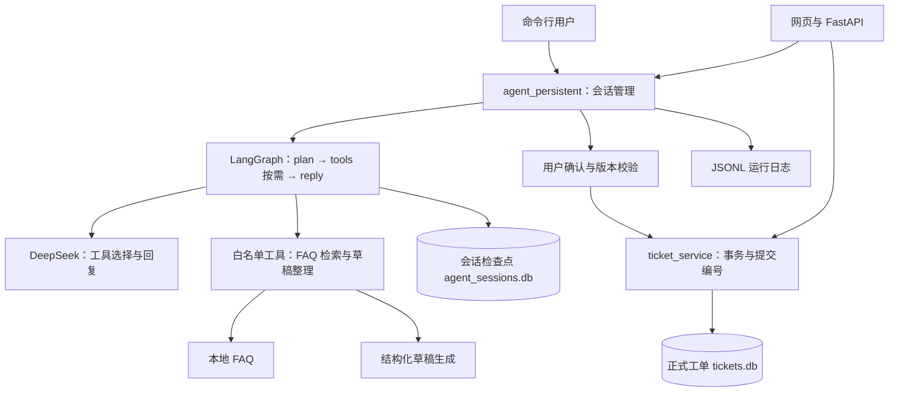

# 企业 FAQ 与工单客服 Agent

**[在线体验（无需安装或密钥）](https://huangfushengxin.github.io/customer-support-agent/)** · [公网演示说明](公网演示说明.md)

在线版为明确标注的前端规则模拟：可体验 FAQ、多轮草稿、确认建单和刷新恢复；
数据仅存于访客自己的浏览器，不调用真实模型，也不运行 Python 后端。
下面是完整 Python / LangGraph / SQLite 项目的本地与 Docker 运行说明。


基于 Python、FastAPI、DeepSeek、LangGraph 和 SQLite 的客服 Agent 学习项目。

支持带来源的 FAQ 问答、多轮整理草稿、人工确认建单、重复确认保护和重启恢复。


## 使用入口


在项目目录运行命令。当前 `pyproject.toml` 要求 Python 3.14 或以上；先安装 uv，

然后执行 `uv sync --locked`，按下文说明配置本地 `.env`。普通对话调用真实模型。


| 入口 | 命令 | 用途 |
|---|---|---|
| 完整 Agent | `uv run python agent_persistent.py` | 多轮对话、确认、恢复、日志 |
| 离线演示 | `uv run python demo_agent_memory.py` | 模拟模型，验证记忆和恢复 |
| 网页 | `uv run uvicorn ticket_api:app --reload` | 完整多轮 Agent、会话恢复、确认建单及工单管理 |
| 全部测试 | `uv run python -m unittest discover -s . -p 'test_*.py' -v` | 使用模拟模型和临时数据库 |
| 检索评测 | `uv run python evaluate_knowledge.py` | 检查固定问题的 FAQ 检索 |


Agent 网页：<http://127.0.0.1:8000/agent-page>；工单管理：<http://127.0.0.1:8000/page>。

完整多轮 Agent 也可以通过命令行使用。网页操作见 [网页 Agent 验收](网页Agent验收.md)。


启动 Agent 后先输入 `/new`，描述问题；核对 `/draft` 后，执行程序显示的

完整 `/confirm 编号` 才会保存。退出后用 `/sessions` 和 `/resume 会话编号` 恢复。


- [Docker 学习](Docker学习.md)：安装、镜像构建、端口与数据卷验收。

- [演示说明](演示说明.md)：完整演示输入、检查点和平台异常时的替代流程。

- [评测记录](评测记录.md)：自动化测试、检索结果、人工验收和当前限制。

- [验收记录](验收记录.md)：使用者填写的业务验收结果。


## 系统结构





模型提出工具调用请求，后端校验并执行；用户确认后由业务函数保存工单。

会话检查点、正式工单和诊断日志各有独立用途。演示数据库与正式数据库分开。


## 已实现功能


- 模型根据用户意图选择白名单工具

- 多轮补充信息，更新草稿和确认版本编号

- LangGraph 流程与 SQLite 检查点恢复

- 确认建单的事务与重复提交保护

- JSONL 运行日志与离线异常测试

- 创建工单

- 查看全部工单

- 按编号查询工单

- 修改工单状态

- SQLite 持久化保存

- 网页操作

- 输入校验与错误提示

- 业务函数和接口自动化测试

- 接入 DeepSeek，生成结构化工单草稿

- AI 提取标题、类别、问题描述和待补充信息

- 网页展示并允许人工修改草稿

- 用户确认后，将草稿保存为正式工单

- 模型超时、网络异常和输出格式错误的处理

- 本地 FAQ 知识库与关键词检索

- 根据检索资料生成回答，并展示来源

- 无匹配资料或依据不足时返回明确提示

- 校验引用编号，拒绝本次检索之外的来源

- 固定问题评测与检索回归测试

## 安装依赖


需要 Python 和 uv。所需 Python 版本见 pyproject.toml。


在项目根目录执行：


```powershell

uv sync

```


## 配置模型


在项目根目录新建 `.env` 文件，参考 `.env.example` 填写：


```dotenv

DEEPSEEK_API_KEY=你自己的密钥

DEEPSEEK_MODEL=deepseek-flash

```


`.env` 保存本地密钥，不提交到 Git。


## 启动网页服务


```powershell

uv run uvicorn ticket_api:app --reload

```


网页：http://127.0.0.1:8000/page


接口文档：http://127.0.0.1:8000/docs


在启动服务的终端按 Ctrl + C 停止。


## 运行命令行版本


```powershell

uv run python ticket_sqlite.py

```


## 运行测试


```powershell

uv run python -m unittest discover -s . -p 'test_*.py' -v

```


目前共有 96 项离线测试，覆盖业务、接口、知识库、Agent、检查点恢复和运行日志。


测试使用独立的临时数据库，不修改日常使用的工单数据。

AI 接口测试使用 Mock 模拟模型返回，不消耗 DeepSeek 额度。

这些测试验证程序流程，模型整理内容的准确性需要通过真实样例另行检查。


## 主要文件


- ticket_service.py：业务校验与数据库操作

- ticket_sqlite.py：命令行菜单

- ticket_api.py：HTTP 接口及网页入口

- index.html：网页界面

- test_ticket_service.py：业务函数测试

- test_ticket_api.py：接口测试

- tickets.db：本地工单数据库

- llm_demo.py：模型调用入门示例

- llm_service.py：调用模型并校验结构化草稿

- test_ticket_drafts.py：草稿生成、异常处理和确认保存测试

- .env.example：模型配置模板

- knowledge/faq.json：演示 FAQ 资料和关键词

- knowledge_service.py：知识库读取与检索

- rag_service.py：根据资料生成回答并校验来源

- test_knowledge.py：检索、回答处理和问答接口测试

- eval_cases.json：固定评测问题及核对标准

- evaluate_knowledge.py：检索与真实模型评测脚本

## 数据说明


首次启动程序会自动创建数据库和工单表。


tickets.db 不提交到 Git，因此从仓库重新获取项目时，

需要重新创建演示工单，原有本地数据不会随代码分发。


## 当前限制


- 尚未加入账号登录和权限控制

- Agent 确认保存已按提交编号防止重复创建；原 /page 的直接创建接口尚未实现服务器端重复请求保护；新 Agent 页确认接口已复用幂等保存

- 知识库目前使用演示 FAQ，需要替换成真实产品资料

- 检索依赖关键词，未覆盖的表达仍可能漏检

- 来源编号有效不代表回答内容一定准确，仍需评测核对

- 网页 Agent 为本机单用户版本，只运行一个 worker；不要同时通过命令行操作同一会话数据库

- AI 草稿需要人工核对，生成草稿本身不会创建正式工单


## 知识库评测


仅评测检索，不消耗模型额度：


```powershell

uv run python evaluate_knowledge.py

```


评测真实模型回答，会消耗 API 额度：


```powershell

uv run python evaluate_knowledge.py --live

```


报告保存在 eval_results 文件夹。

自动检查验证检索、状态和来源编号，回答内容需要人工核对。

当前固定的10道检索题全部通过，不代表任意问题都能正确检索。


## 第五阶段 Agent 入口


- agent_tools.py：工具白名单、参数校验、FAQ 检索与草稿整理。

- agent_service.py：多轮会话、回复来源校验、人工确认和草稿版本编号。

- agent_graph.py：LangGraph 的 plan、tools、reply 节点及条件分支。

- agent_persistent.py：SQLite 检查点与会话恢复。

- demo_agent_memory.py：模拟模型的离线演示。

- ticket_service.py：工单与提交编号在同一事务中保存，重复确认返回原工单编号。


第五步，运行 LangGraph 对话（会调用真实模型）：


```powershell

uv run python agent_graph.py

```


第六步，运行支持重启恢复的对话（会调用真实模型）：


```powershell

uv run python agent_persistent.py

```


平台不可用时，可运行离线演示（使用模拟模型）：


```powershell

uv run python demo_agent_memory.py

```


持久会话命令：/new、/sessions、/resume 会话编号、/draft、/history、/confirm 草稿编号、exit。


正式会话使用 agent_sessions.db，正式工单使用 tickets.db。

离线演示使用 agent_sessions_demo.db 和 tickets_demo.db。

这些数据库不提交到 Git。


离线测试通过不代表真实模型已验收。真实联网验收需要检查 FAQ 回答、

两轮补充后的草稿内容以及人工确认保存是否符合实际预期。


.env.example 只保存占位符；真实密钥仅放在 .env 中。


## 第六阶段：运行日志


启动持久会话入口：


```powershell

uv run python agent_persistent.py

```


启动时显示日志路径。正式入口写入 `logs/agent_sessions.jsonl`；离线演示

`demo_agent_memory.py` 写入 `logs/agent_sessions_demo.jsonl`。

每次普通对话或确认操作记录一行 JSON；查看历史、查看草稿等本地命令不记录。

日志目录不提交到 Git。


主要字段：


| 字段 | 含义 |
|---|---|
| time | 带时区的本机时间 |
| event_id | 本次操作编号 |
| thread_id | 会话编号 |
| operation | turn 对话、confirm 确认 |
| outcome | success 成功、error 失败 |
| duration_ms | 整次操作耗时，单位毫秒，包含模型、工具和检查点操作 |
| status | 成功对话的业务状态，例如 need_info、draft_ready |
| flow_nodes / tools | 成功对话执行的节点、工具名称 |
| ticket_id / already_saved | 确认返回的工单编号、是否已保存 |
| error_type / http_status | 错误类别；模型 HTTP 错误还包含状态码 |
| ticket_committed | 工单已提交但检查点更新失败时为 true，可用原命令重试 |


日志不保存用户问题、模型回复、草稿、工具参数、确认编号、密钥或原始异常文本。

错误事件记录操作级别的失败，不声称尚未完成的节点或工具已经成功。

日志写入失败会提示，业务原本的成功或失败结果保持不变。

当前不统计模型 token 和费用，也没有自动清理日志；这是本地单进程学习版本。


查看最后 5 条：


```powershell

Get-Content .\logs\agent_sessions.jsonl -Encoding UTF8 -Tail 5

```


仅验证日志相关场景，不调用真实模型：


```powershell

uv run python -m unittest test_agent_observability -v

```


覆盖正常对话、重复确认、超时、HTTP 错误、错误确认编号、工单提交后检查点失败，

以及日志不可写时业务仍可完成。测试使用临时数据库和临时日志。


## 可选扩展：Docker


已提供 Dockerfile、compose.yaml 和 .dockerignore。应用支持通过环境变量

AGENT_DATA_DIR 指定数据库目录；不设置时继续使用本机项目目录。

Compose 把 /data 挂载到命名卷，保存工单、会话及日志；本机数据库不会自动复制到卷里。


先按 [Docker 学习](Docker学习.md) 安装并启动 Docker Desktop，再执行：


```powershell

docker compose build

docker compose up -d

```


访问 http://127.0.0.1:8000/page。后台服务如已占用 8000 端口，先停止原服务。

离线 Agent：`docker compose run --rm web python demo_agent_memory.py`。

正式 Agent：`docker compose run --rm web python agent_persistent.py`。

停止网页容器使用 `docker compose down`，默认保留卷；不要加 `-v`，以免删除卷内数据。


Docker 初次验收时通过 84 项离线测试；新增网页 Agent 后，Linux 断网临时容器内共 96 项通过。镜像构建、健康检查、工单与会话跨容器重建恢复已实际验证。最新真实网页操作记录见 [验收记录](验收记录.md)。

### 多轮回复格式修复（2026-11-12）

历史助手消息中的 reply/draft/sources 是程序存储格式。发给模型时只取 reply 正文，
当前草稿仍由独立状态提供；最终提示再次明确 status/reply/citation_ids 格式。
不符合格式的回复仍被拒绝，保留最后成功的会话和草稿，不自动重试收费请求。
相关回归测试为 test_agent_reply_format.py。
修复后的 Linux 镜像内 88 项测试通过；独立临时会话中的两轮真实模型复验通过，
覆盖草稿生成、补充版本与系统、关闭后恢复，未保存正式工单。
这不代表已经重放使用者原会话或完成容器内真实知识问答和确认建单的全部验收。


### 网页 Agent 接入（2026-11-12）

新增 agent_api.py 与 agent.html，复用现有 LangGraph、会话检查点和确认保存流程。
支持会话列表、多轮补充、刷新恢复、只读草稿核对及版本确认；历史正文使用 textContent 渲染。
单进程遇到重叠请求返回 409，模型异常保留最后成功状态，不自动重试。

本次 Linux 断网临时容器内 96 项测试通过（84.837 秒）；隔离模拟模型网页已实测
两轮输入、刷新恢复、确认保存及在原工单页按编号查询。正式 Docker 服务已更新并健康，
现有会话列表可见。使用者随后完成真实两轮网页对话并保存工单 3，反馈没有报错；容器重建后会话、草稿和工单仍一致。回答质量与来源合理性仍需人工评阅。
